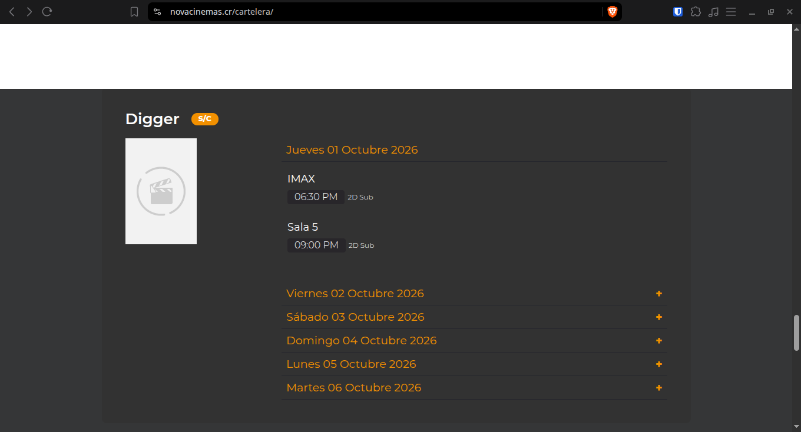
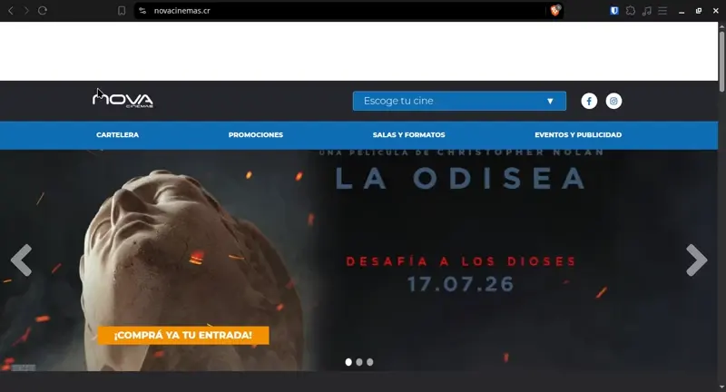

# Funcionalidad 1: Consulta de cartelera

[← Volver al Índice](./README.md)

---

# Caso de Prueba: Selección y filtrado de cartelera por sucursal

## ID

CT-CAR-01

## Objetivo

Verificar que al seleccionar una sucursal en la página principal, el sistema pase de la vista general (estrenos, preventa, promociones y noticias) a la cartelera específica y horarios de la sucursal escogida.

## Precondiciones

- Acceso a navegador actualizado.
- Conexión estable a Internet.
- Estar en la página principal de inicio: [https://www.novacinemas.cr](https://www.novacinemas.cr)

## Datos de Entrada

- Sucursal seleccionada: *Ciudad del Este Curridabat*

## Pasos

1. Acceder a la página de inicio ([https://www.novacinemas.cr](https://www.novacinemas.cr)).
2. Confirmar que en esta pantalla se muestre una vista general de estrenos, preventas, algunas promociones y noticias.
3. Ubicar en el menú la opción de "Cartelera".
4. Hacer clic en el selector "Elegir Cine :" y escoger "Ciudad del Este Curridabat"
5. Observar la lista de películas disponibles en esa sucursal junto a sus respectivos horarios.

## Resultado Esperado

- La interfaz se actualiza mostrando una lista de películas junto a las fechas y horarios en los que puede comprar una entrada.
- No se muestran errores visibles, mensajes de error o imágenes rotas.

## Resultado Obtenido

- El sistema permitió acceder a la página de cartelera y mostró una lista de películas disponibles en la sucursal de "Cuidad del Este Curridabat", junto a la fecha y las horas en las que hay tandas disponibles.

## Estado de la prueba

⚠️ Dudoso

## Observaciones

- Se encontró que una de las películas próximas a estrenarse se encuentra sin su respectiva imagen, en su lugar está un placeholder. Sin embargo, este muestra todos los horarios disponibles para poder comprar una entrada.

---

# Caso de Prueba: Filtrado de tandas por fecha

## ID

CT-CAR-02

## Objetivo

Verificar que la cartelera actualice los horarios y tandas disponibles al seleccionar una fecha diferente en el menú de fechas.

## Precondiciones

- Acceso a navegador actualizado.
- Conexión estable a Internet.
- Haber seleccionado una sucursal previamente (ej. Ciudad del Este Curridabat).

## Datos de Entrada

- Fecha seleccionada: Día posterior al actual, según los disponibles en la lista de fechas (ej. mañana / próximo fin de semana).

## Pasos

1. Identificar el menú desplegable de fechas/días disponibles. (*Elegir fecha :*)
2. Hacer clic sobre una fecha distinta a la fecha por defecto (día de hoy).
3. Observar la lista de películas y tandas disponibles.

## Resultado Esperado

- La interfaz se actualiza mostrando únicamente las películas y sus horarios de tanda correspondientes a la fecha seleccionada.

## Resultado Obtenido

- El listado de películas y sus horarios se actualizaron correctamente al cambiar la fecha en el menú de selección.

## Estado de la prueba

✅ Pasó

## Observaciones

- El sitio restringe las fechas exclusivamente a los días que poseen películas o preventas con tandas disponibles para realizar una compra de entradas.

---

# Caso de Prueba: Visualización de detalles y formato de películas.

## ID

CT-CAR-03

## Objetivo

Verificar que cada película en la cartelera despliegue correctamente su poster, clasificación de edad y formatos de proyección disponibles (2D, 3D, IMAX, 2D Dob).

## Precondiciones

- Acceso a navegador actualizado.
- Conexión estable a Internet.
- Estar en el sitio de la cartelera de cualquier sucursal activa.

## Datos de Entrada

- No Aplica (Verificación visual)

## Pasos

1. Navegar por el listado de películas desplegado en la cartelera.
2. Inspeccionar visualmente los posters, títulos, etiquetas de formato (2D/3D/IMAX) y restricciones de edad (TP, +12, +18).
3. Verificar que todos los elementos gráficos carguen adecuadamente.

## Resultado Esperado

- Cada película muestra su poster completo, título, formatos de las tandas disponibles (3D, 2D Dob, IMAX) y la clasificación por edad visible.

## Resultado Obtenido

- La mayoría de películas muestran sus detalles correctamente, incluso las que aún no tienen una clasificación de edad muestra S/C. Sin embargo, una de las películas listadas no carga la imagen de su poster, mostrando únicamente un placeholder.

## Estado de la prueba

❌ Falló

## Observaciones

- Recurso faltante: Una película próxima a estrenarse no carga la imagen de su poster, mostrando solo un placeholder

- Adicionalmente se encontró que en PC, si se entra a la cartelera de la sucursal con el menú desplegable en la barra del logo, se entra a una cartelera que permite hacer clic al poster y este solo manda a un sitio con la palabra ERROR.

---

# Caso de Prueba: Selección de tanda e inicio flujo de compra

## ID

CT-CAR-04

## Objetivo

Verificar que al seleccionar un horario específico (tanda), el sistema responda redirigiendo correctamente al apartado de selección de boletos.

## Precondiciones

- Acceso a navegador actualizado.
- Conexión estable a Internet.
- Cartelera cargada con películas y horarios disponibles.

## Datos de Entrada

- Selección de una tanda (ej. 07:00 PM en formato 2D Dob)

## Pasos

1. Entrar en la cartelera 
2. Seleccionar una sucursal 
3. Escoger una película del listado.
2. Hacer clic directamente sobre el botón de un horario disponible (ej. 07:00 PM).

## Resultado Esperado

- El sistema procesa la selección y redirige al usuario a la siguiente página para la selección de tipo y cantidad de boletos y muestra información sobre la película seleccionada (título, fecha, hora, formato y sala)

## Resultado Obtenido

- Al hacer clic en la hora elegida, la página redirigió inmediatamente a la siguiente fase del proceso de reserva respetando la selección hecha.

## Estado de la prueba

✅ Pasó

## Observaciones

- **Nota sobre entorno de ejecución:** Se identificó que al ejecutar la prueba en un entorno con bloqueadores de publicidad o filtro de red (AdBlock / Pi-hole), la redirección entra en un bucle infinito (`ERR_TOO_MANY_REDIRECTS`) para el apartado de selección de boletos. Sin embargo, en un navegador sin estas restricciones, el sistema funciona correctamente.
