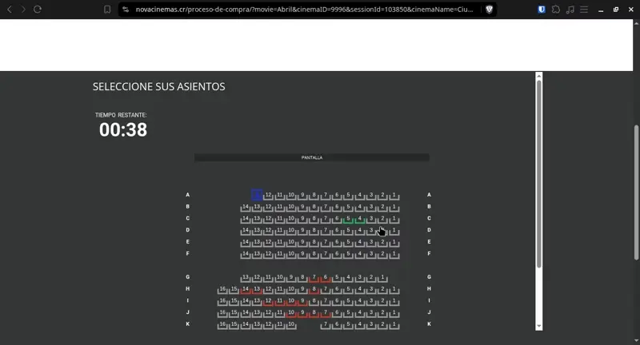

# Funcionalidad 2: Mapa interactivo de asientos

[← Volver al Índice](./README.md)

---

# Caso de Prueba: Selección y mapa de asientos

## ID

CT-MAP-01

## Objetivo

Verificar que la sala de cine se renderice correctamente en un mapa gráfico interactivo y permita seleccionar butacas disponibles modificando su estado visual.

## Precondiciones

- Acceso a navegador actualizado (Evitar el uso de bloqueadores de trackers y anuncios).
- Conexión estable a Internet.
- Haber seleccionado una película y tanda válida desde la cartelera.

## Datos de Entrada

- Cantidad de entradas: 2 boletos de adulto.
- Asientos seleccionadas: Asientos libres en zona media (ej. D5, D6).

## Pasos

1. Seleccionar una película y una tanda válida.
2. Seleccionar 2 boletos para adulto.
3. Verificar el despliegue visual de la pantalla (ubicación de la pantalla de proyección, simbología de asientos libres, ocupados y seleccionados).
4. Hacer clic sobre una o más butacas en estado disponible.

## Resultado Esperado

- El mapa interactivo se carga de manera clara sin superposición de elementos gráficos.
- Cada clic en una butaca disponible actualiza inmediatamente su color pasando de gris a verde, según la simbología.

## Resultado Obtenido

- El mapa de asientos se desplegó de forma gráfica e interactiva. Al seleccionar las butacas, estas cambiaron de color en tiempo real de forma correcta.

## Estado de la prueba

✅ Pasó

## Observaciones

- Ninguna, todo funcionó de forma correcta.

---

# Caso de Prueba: Restricción de selección de asientos ocupados o no disponibles

## ID

CT-MAP-02

## Objetivo

Verificar que el mapa de asientos impida la interacción o selección de butacas que ya han sido reservadas por otros usuarios o que estén restringidos.

## Precondiciones

- Acceso a navegador actualizado.
- Conexión estable a Internet.
- Selección de una función que cuente con asientos previamente ocupados (rojo).

## Datos de Entrada

- Selección de un asiento ya ocupado.

## Pasos

1. Seleccionar una película y una tanda disponible.
2. Seleccionar 1 o 2 boletos.
3. Identificar dentro del mapa una butaca cuyo estado gráfico sea "Ocupado".
4. Intentar hacer clic directamente sobre dicha butaca.

## Resultado Esperado

- El sistema no debe reaccionar al clic sobre butacas ocupadas.

## Resultado Obtenido

- Las butacas marcadas como ocupadas no permiten selección ni causan cambios en los asientos actualmente asignados.

## Estado de la prueba

✅ Pasó

## Observaciones

- Ninguna

---

# Caso de Prueba: Control y validación del temporizador de reserva (Timer)

## ID

CT-MAP-03

## Objetivo

Verificar que la pantalla de selección de asientos despliegue un temporizador en vivo para la reserva temporal y que al expirar el tiempo impida continuar la transacción.

## Precondiciones

- Acceso a navegador actualizado.
- Conexión estable a Internet.
- Estar en la pantalla del mapa interactivo con al menos un asiento seleccionado.

## Datos de Entrada

- No Aplica (Verificación visual)

## Pasos

1. Seleccionar un asiento/s en el mapa interactivo.
2. Identificar la cuenta regresiva del temporizador de sesión en la interfaz.
3. Permitir que el contador llegue a 00:00 sin interactuar con el botón de siguiente.
4. Observar la reacción del sistema tras la expiración del tiempo.

## Resultado Esperado

- El contador visible descuenta el tiempo segundo a segundo.
- Al llegar a 00:00, el sistema cancela la reserva temporal, libera los asientos seleccionados y despliega una aviso sobre que la sesión se terminó.

## Resultado Obtenido

- Al terminar el temporizador, el sistema mostró un mensaje en pantalla advirtiendo sobre el tiempo agotado. 

**Mensaje:** *Se acabó el tiempo. Lo sentimos, pero su sesión expiró.*

## Estado de la prueba

✅ Pasó

## Observaciones

- **Nota de UX:** Cuando el tiempo está cerca de acabarse, se muestran avisos de que quedan pocos minutos/segundos para que se acabe la sesión. Dicho mensaje mueve el mapa de asientos unos pixeles hacia abajo al aparecer, lo que podría causar un error por parte del usuario al momento de seleccionar un asiento y terminar seleccinando otro que no deseaba.

---
# Caso de Prueba: Reubicación de asientos asignados por defecto

## ID

CT-MAP-04

## Objetivo

Validar que el mapa permita trasladar el bloque de asientos asignados automáticamente por el sistema hacia una nueva posición dentro de la sala, liberando la ubicación inicial.

## Precondiciones

- Acceso a navegador actualizado.
- Conexión estable a Internet.
- Estar en el mapa de asientos.

## Datos de Entrada

- **Ubicación inicial:** Asientos predeterminados (ej. A1, A2).
- **Nueva posición:** Clic en fila central (ej. F8, F9).

## Pasos

1. Ingresar al mapa interactivo e identificar la posición asignada por defecto por el sistema.
2. Hacer clic en una fila/columna diferente con capacidad suficiente para las entradas requeridas.
3. Verificar que los asientos iniciales vuelvan al estado "Disponible" y los nuevos asuman el estado "Seleccionado".

## Resultado Esperado

- El sistema libera la posición previa y reasigna los asientos al nuevo punto marcado sin duplicar asientos asignados ni bloquear la ubicación anterior.

## Resultado Obtenido

- El sistema mostró correctamente la asignación de los asientos escogidos y desmarcó los asientos anteriormente asignados y los puso como espacios disponibles nuevamente.

## Estado de la prueba

✅ Pasó

## Observaciones

- Ninguna
