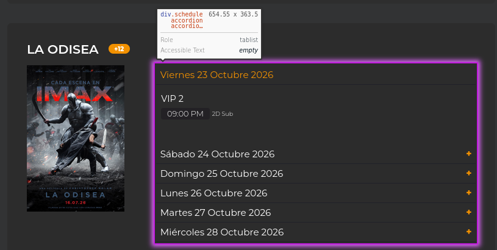

# 🐞 Reporte de Bug

## ID

BUG-001

## Título

El acordión de horarios usa roles ARIA con hijos no permitidos (`role="tabpanel"`)

## Estado

- [x] Nuevo
- [ ] En revisión
- [ ] En desarrollo
- [ ] Resuelto
- [ ] Cerrado

## Reportado por

Roberto Méndez

## Fecha de detección

2026-10-22

## Prioridad

- 🟡 Media

## Descripción

El análisis de accesibilidad reporta la regla **"Certain ARIA roles must contain particular children"**: los elementos con un rol ARIA que exige roles hijos específicos deben contenerlos. El contenedor del acordeón de horarios (`div.schedules-accordion.ui-accordion.ui-widget.ui-helper-reset`) tiene un rol que no admite como hijos directos elementos con `role="tabpanel"`, pero el panel de contenido del acordeón (`div.rowTimes.ui-accordion-content.ui-accordion-content-active`, `id="ui-id-61"`) se marca con ese rol.

Como resultado, los lectores de pantalla no pueden interpretar correctamente la estructura del acordeón.

## Pasos para reproducir

1. Acceder a [https://www.novacinemas.cr](https://www.novacinemas.cr).
2. Ir a la cartelera de una sucursal y desplegar los horarios de una película (acordeón de tandas).
3. Ejecutar un análisis de accesibilidad con axe DevTools sobre la página.
4. Revisar el resultado de la regla "Certain ARIA roles must contain particular children".

## Resultado esperado

- Los elementos con rol ARIA contienen únicamente los roles hijos permitidos por la especificación WAI-ARIA (por ejemplo, un `tablist` con `tab`, y los `tabpanel` fuera de él, o bien un patrón de acordeón con botones `aria-expanded` y regiones asociadas).
- La herramienta de análisis no reporta violaciones de esta regla.

## Resultado obtenido

- Se reporta la violación: `Element has children which are not allowed: [role=tabpanel]`.
- Ubicación del elemento (selector parcial): `... > .col:nth-child(2) > .wi-accordion.ui-widget[role=...]`.
- Nodo relacionado: `
`.

## Evidencia

- Captura de pantalla: 

## Entorno de pruebas

- Navegador: Zen Browser 1.23.4b (Firefox)
- Dispositivo: Escritorio
- Sistema operativo: Linux (Fedora 44)
- URL o versión del sistema: [https://www.novacinemas.cr](https://www.novacinemas.cr)
- Herramienta: axe DevTools (axe Core 4.10.3)
- Estándar evaluado: WCAG 2.1 nivel AA

## Notas adicionales

- Referencia: [axe — aria-required-children](https://dequeuniversity.com/rules/axe/4.10/aria-required-children)
- Estándar WCAG 2.1 AA
