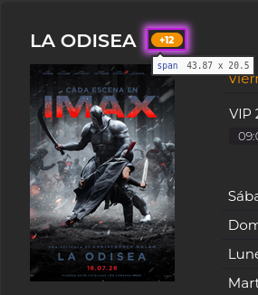
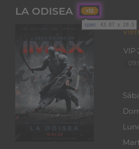

# 🐞 Reporte de Bug

## ID

BUG-002

## Título

Las etiquetas de clasificación de edad no cumplen el contraste mínimo de color (2.37:1)

## Estado

- [x] Nuevo
- [ ] En revisión
- [ ] En desarrollo
- [ ] Resuelto
- [ ] Cerrado

## Reportado por

Roberto Méndez

## Fecha de detección

2026-10-22

## Prioridad

- 🟡 Media

## Descripción

El análisis de accesibilidad reporta la regla **"Elements must meet minimum color contrast ratio thresholds"**: el contraste entre el texto y el fondo debe cumplir el mínimo WCAG 2 AA. La etiqueta de clasificación por edad (por ejemplo `+12`), ubicada al lado del título de la película, tiene un contraste de **2.37:1**, muy por debajo del **4.5:1** requerido para texto de su tamaño.

Esto dificulta la lectura de la clasificación de la película para usuarios con baja visión o daltonismo, y en condiciones de poca luz o pantallas de bajo brillo.

## Pasos para reproducir

1. Acceder a [https://www.novacinemas.cr](https://www.novacinemas.cr).
2. Ir a la cartelera de una sucursal.
3. Ejecutar un análisis de accesibilidad con axe DevTools sobre la página.
4. Revisar el resultado de la regla "Elements must meet minimum color contrast ratio thresholds".

## Resultado esperado

- El texto de la etiqueta tiene un contraste de al menos 4.5:1 con su fondo (WCAG 2.1, criterio 1.4.3, nivel AA).

## Resultado obtenido

- Se reporta: `Element has insufficient color contrast of 2.37 (foreground color: #ffffff, background color: #f29100, font size: 9.4pt (12.5px), font weight: bold). Expected contrast ratio of 4.5:1`.
- Ubicación del elemento (selector parcial): `... > .titleBar > span`.
- Nodo relacionado: `+12`.

## Evidencia

- Captura de pantalla: 

- Captura con simulación de bajo contraste:

- Etiquetas del reporte: `cat.color`
`wcag2aa`
`wcag143`
`TTv5`
`TT13.c`
`EN-301-549`
`EN-9.1.4.3`
`ACT`

## Entorno de pruebas

- Navegador: Zen Browser 1.23.4b (Firefox)
- Dispositivo: Escritorio
- Sistema operativo: Linux (Fedora 44)
- URL o versión del sistema: [https://www.novacinemas.cr](https://www.novacinemas.cr)
- Herramienta: axe DevTools (axe Core 4.10.3)
- Estándar evaluado: WCAG 2.1 nivel AA

## Notas adicionales

- Solución sugerida: oscurecer el color de fondo de la etiqueta o aumentar el tamaño del texto (a partir de 14pt en negrita el mínimo baja a 3:1).