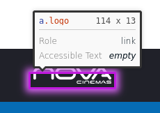

# 🐞 Reporte de Bug

## ID

BUG-003

## Título

El enlace del logo no tiene texto accesible para lectores de pantalla

## Estado

- [x] Nuevo
- [ ] En revisión
- [ ] En desarrollo
- [ ] Resuelto
- [ ] Cerrado

## Reportado por

Roberto Méndez

## Fecha de detección

2026-10-22

## Prioridad

- 🟠 Alta (afecta al usuario de forma notoria)

## Descripción

El análisis de accesibilidad reporta la regla **"Links must have discernible text"**: todo enlace debe tener un texto que pueda ser identificado. El enlace del logo (`<a class="Logo" href="https://www.novacinemas.cr">`), que contiene la imagen `Logo.svg`, está en el orden de tabulación pero no tiene un nombre accesible: la imagen no aporta texto alternativo válido y el enlace no tiene `aria-label`, `aria-labelledby` ni `title`.

Un usuario de lector de pantalla que navega con teclado escucha solo "enlace" (o la URL) sin saber que lleva a la página de inicio. El logo está presente en todas las páginas del sitio, por lo que el problema se repite en todo el recorrido.

## Pasos para reproducir

1. Acceder a [https://www.novacinemas.cr](https://www.novacinemas.cr).
2. Ejecutar un análisis de accesibilidad con axe DevTools sobre la página.
3. Revisar el resultado de la regla "Links must have discernible text".
4. (Opcional) Activar un lector de pantalla (NVDA, VoiceOver) y navegar con `Tab` hasta el logo.

## Resultado esperado

- El enlace del logo tiene un nombre accesible, por ejemplo "Nova Cinemas – Inicio", mediante un `alt` descriptivo en la imagen o un `aria-label` en el enlace.

## Resultado obtenido

- Ubicación del elemento: `.Logo`.
- Se reporta que se debe corregir al menos uno de los siguientes:
  - El elemento no tiene texto visible para lectores de pantalla.
  - El atributo `aria-label` no existe o está vacío.
  - El atributo `aria-labelledby` no existe, referencia elementos inexistentes o vacíos.
  - El elemento no tiene atributo `title`.
- Y además: `Element is in tab order and does not have accessible text`.

## Evidencia

- Captura de pantalla:

- Etiquetas del reporte:
cat.name-role-value
`wcag2a`
`wcag244`
`wcag412`
`section508`
`section508.22.a`
`TTv5`
`TT6.a`
`EN-301-549`
`EN-9.2.4.4`
`EN-9.4.1.2`
`ACT`

## Entorno de pruebas

- Navegador: Zen Browser 1.23.4b (Firefox)
- Dispositivo: Escritorio
- Sistema operativo: Linux (Fedora 44)
- URL o versión del sistema: [https://www.novacinemas.cr](https://www.novacinemas.cr)
- Herramienta: axe DevTools (axe Core 4.10.3)
- Estándar evaluado: WCAG 2.1 nivel AA

## Notas adicionales

- Incumple WCAG 2.1, criterios 2.4.4 (Propósito de los enlaces) y 4.1.2 (Nombre, función, valor).
- Este error se presenta en 21 ocasiones dentro en la página de cartelera, múltiples viniendo de los posters de las películas.

