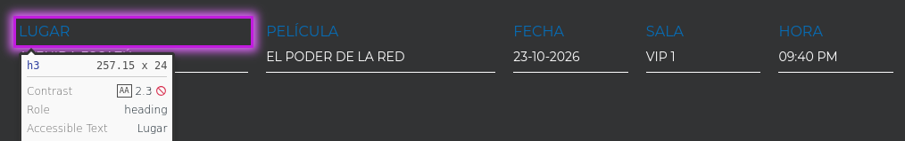
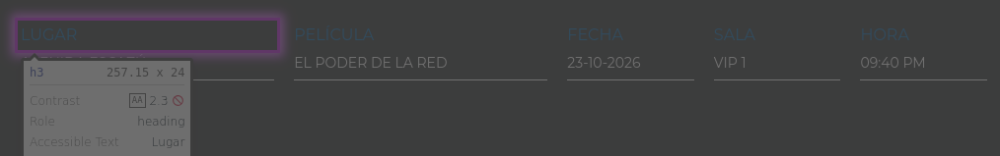

# 🐞 Reporte de Bug

## ID

BUG-004

## Título

El título "Lugar" no cumple el contraste mínimo de color (2.3:1)

## Estado

- [x] Nuevo
- [ ] En revisión
- [ ] En desarrollo
- [ ] Resuelto
- [ ] Cerrado

## Reportado por

Roberto Méndez

## Fecha de detección

2026-10-23

## Prioridad

- 🟡 Media

## Descripción

El análisis de accesibilidad reporta la regla **"Elements must meet minimum color contrast ratio thresholds"** (impacto: *serious*) en 5 elementos de la página. Uno de ellos es el encabezado `<h3>Lugar</h3>`, cuyo texto azul (`#066cb5`) sobre el fondo gris oscuro (`#323334`) tiene un contraste de **2.3:1**, muy por debajo del **4.5:1** que exige WCAG 2 AA para texto de 16px con peso normal.

El texto es difícil de leer para usuarios con baja visión o daltonismo, y también en pantallas de bajo brillo o con reflejos.

## Pasos para reproducir

1. Acceder a [https://www.novacinemas.cr](https://www.novacinemas.cr).
2. Navegar a la sección donde se muestra el encabezado "Lugar".
3. Ejecutar un análisis de accesibilidad con axe DevTools sobre la página.
4. Revisar el resultado de la regla "Elements must meet minimum color contrast ratio thresholds".

## Resultado esperado

- El texto del encabezado tiene un contraste de al menos 4.5:1 con su fondo (WCAG 2.1, criterio 1.4.3, nivel AA).

## Resultado obtenido

- Se reporta: `Element has insufficient color contrast of 2.3 (foreground color: #066cb5, background color: #323334, font size: 12.0pt (16px), font weight: normal). Expected contrast ratio of 4.5:1`.
- Ubicación del elemento: `.col:nth-child(1) > h3`.
- Nodo relacionado: `<main class="page template">`.
- La regla reporta 5 elementos afectados en total.

## Evidencia

- Captura de pantalla: 

- Captura de pantalla con simulación de falta de contraste:

- Etiquetas del reporte: `cat.color`, `wcag2aa`, `wcag143`, `TTv5`, `TT13.c`, `EN-301-549`, `EN-9.1.4.3`, `ACT`.

## Entorno de pruebas

- Navegador: Zen Browser 1.23.4b (Firefox)
- Dispositivo: Escritorio
- Sistema operativo: Linux (Fedora 44)
- URL o versión del sistema: [https://www.novacinemas.cr](https://www.novacinemas.cr)
- Herramienta: axe DevTools (axe Core 4.10.3), detectado automáticamente el 2026-10-23 a las 6:19 p. m.
- Estándar evaluado: WCAG 2.1 nivel AA

## Notas adicionales

- Solución sugerida: usar un azul más claro para el texto sobre fondo oscuro, o un fondo más claro, hasta alcanzar 4.5:1.

- Relacionado con [BUG-002](./02-contraste-color-insuficiente.md).

