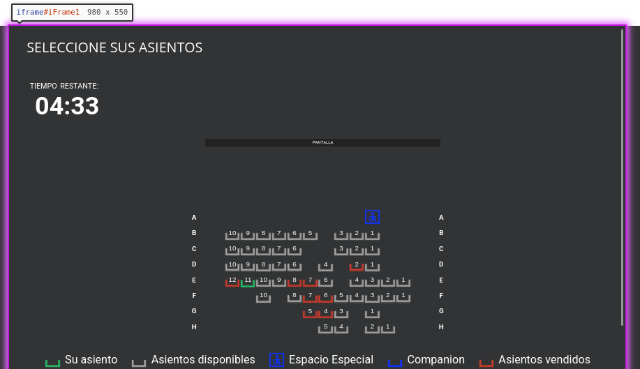

# 🐞 Reporte de Bug

## ID

BUG-005

## Título

El iframe de compra de boletos (`#iFrame1`) no tiene nombre accesible

## Estado

- [x] Nuevo
- [ ] En revisión
- [ ] En desarrollo
- [ ] Resuelto
- [ ] Cerrado

## Reportado por

Roberto Méndez

## Fecha de detección

2026-10-23

## Prioridad

- 🟠 Alta (afecta al usuario de forma notoria)

## Descripción

El análisis de accesibilidad reporta la regla **"Frames must have an accessible name"** (impacto: *serious*): los elementos `<iframe>` y `<frame>` deben tener un nombre accesible. El iframe `#iFrame1`, que carga el sistema de venta de boletos (`web-ticketing.novacinemas.cr/Ticketing/visSelectTickets.aspx`), no tiene `title`, `aria-label` ni `aria-labelledby`.

Un usuario de lector de pantalla no sabe qué contiene el marco al llegar a él. Como el iframe aloja el flujo de compra de entradas, el problema afecta directamente a la funcionalidad principal del sitio.

## Pasos para reproducir

1. Acceder a [https://www.novacinemas.cr](https://www.novacinemas.cr).
2. Ir a la cartelera de una sucursal y seleccionar una tanda para comprar boletos.
3. En la página de selección de boletos, ejecutar un análisis de accesibilidad con axe DevTools.
4. Revisar el resultado de la regla "Frames must have an accessible name".

## Resultado esperado

- El iframe tiene un nombre accesible que describe su contenido, por ejemplo `title="Compra de boletos"`.

## Resultado obtenido

- Ubicación del elemento: `#iFrame1`.
- Elemento: `<iframe id="iFrame1" data-type="has-loader" src="https://web-ticketing.novacinemas.cr/Ticketing/visSelectTickets.aspx?cinemacode=9999&txtSessionId=87267&visLang=1&AspxAutoDetectCookieSupport=1" frameborder="0" width="100%" style="height: 550px!important"></iframe>`.
- Se reporta que se debe corregir al menos uno de los siguientes:
  - El elemento no tiene atributo `title`.
  - El atributo `aria-label` no existe o está vacío.
  - El atributo `aria-labelledby` no existe, referencia elementos inexistentes o vacíos.
  - La semántica por defecto del elemento no se anuló con `role="none"` o `role="presentation"`.

## Evidencia

- Captura de pantalla: 

- Etiquetas del reporte: `cat.text-alternatives`, `wcag2a`, `wcag412`, `section508`, `section508.22.i`, `TTv5`, `TT12.d`, `EN-301-549`, `EN-9.4.1.2`.

## Entorno de pruebas

- Navegador: Zen Browser 1.23.4b (Firefox)
- Dispositivo: Escritorio
- Sistema operativo: Linux (Fedora 44)
- URL o versión del sistema: [https://www.novacinemas.cr](https://www.novacinemas.cr) (iframe: `web-ticketing.novacinemas.cr`)
- Herramienta: axe DevTools (axe Core 4.10.3)
- Estándar evaluado: WCAG 2.1 nivel AA

## Notas adicionales

- Incumple WCAG 2.1, criterio 4.1.2 (Nombre, función, valor).
- Solución sugerida: agregar `title="Compra de boletos"` (o similar) al `<iframe>`.

