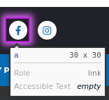

# 🐞 Reporte de Bug

## ID

BUG-006

## Título

Los enlaces de redes sociales (ícono de Facebook) no tienen texto accesible

## Estado

- [x] Nuevo
- [ ] En revisión
- [ ] En desarrollo
- [ ] Resuelto
- [ ] Cerrado

## Reportado por

Roberto Méndez

## Fecha de detección

2026-10-23

## Prioridad

- 🟡 Media 

## Descripción

El análisis de accesibilidad reporta la regla **"Links must have discernible text"** (impacto: *serious*) en 3 enlaces. Uno de ellos es el enlace a la página de Facebook de Nova Cinemas, que solo contiene un ícono de Font Awesome (`<i class="fab fa-facebook-f"></i>`) sin texto alternativo. El enlace está en el orden de tabulación pero no tiene `aria-label`, `aria-labelledby`, `title` ni texto visible para lectores de pantalla.

Un usuario de lector de pantalla escucha solo "enlace" o la URL, sin saber que lleva a Facebook. Además, el enlace se abre en una pestaña nueva (`target="_blank"`) sin avisarlo.

## Pasos para reproducir

1. Acceder a [https://www.novacinemas.cr](https://www.novacinemas.cr).
2. Ejecutar un análisis de accesibilidad con axe DevTools sobre la página.
3. Revisar el resultado de la regla "Links must have discernible text".
4. (Opcional) Activar un lector de pantalla y navegar con `Tab` hasta los íconos de redes sociales.

## Resultado esperado

- Cada enlace de red social tiene un nombre accesible, por ejemplo `aria-label="Facebook de Nova Cinemas (abre en una pestaña nueva)"`, y el ícono decorativo se oculta con `aria-hidden="true"`.

## Resultado obtenido

- Ubicación del elemento: `.container > ul > li:nth-child(1) > a[target="_blank"]`.
- Elemento: `<a target="_blank" href="https://www.facebook.com/novacinemascr"><i class="fab fa-facebook-f"></i></a>`.
- Se reporta que se debe corregir al menos uno de los siguientes:
  - El elemento no tiene texto visible para lectores de pantalla.
  - El atributo `aria-label` no existe o está vacío.
  - El atributo `aria-labelledby` no existe, referencia elementos inexistentes o vacíos.
  - El elemento no tiene atributo `title`.
- Y además: `Element is in tab order and does not have accessible text`.
- La regla reporta 3 enlaces afectados en total.

## Evidencia

- Captura de pantalla:

- Etiquetas del reporte: `cat.name-role-value`, `wcag2a`, `wcag244`, `wcag412`, `section508`, `section508.22.a`, `TTv5`, `TT6.a`, `EN-301-549`, `EN-9.2.4.4`, `EN-9.4.1.2`, `ACT`.

## Entorno de pruebas

- Navegador: Zen Browser 1.23.4b (Firefox)
- Dispositivo: Escritorio
- Sistema operativo: Linux (Fedora 44)
- URL o versión del sistema: [https://www.novacinemas.cr](https://www.novacinemas.cr)
- Herramienta: axe DevTools (axe Core 4.10.3), detectado automáticamente el 2026-10-23 a las 6:19 p. m.
- Estándar evaluado: WCAG 2.1 nivel AA

## Notas adicionales

- Incumple WCAG 2.1, criterios 2.4.4 (Propósito de los enlaces) y 4.1.2 (Nombre, función, valor).
- Los otros 2 enlaces que reporta la misma regla son relacionadas al logo y demás redes sociales.
- Relacionado con [BUG-003](./03-enlace-logo-sin-texto.md).

