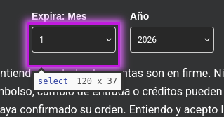

# 🐞 Reporte de Bug

## ID

BUG-007

## Título

Las listas desplegables (`<select>`) del formulario de compra no tienen nombre accesible

## Estado

- [x] Nuevo
- [ ] En revisión
- [ ] En desarrollo
- [ ] Resuelto
- [ ] Cerrado

## Reportado por

Roberto Méndez

## Fecha de detección

2026-10-23

## Prioridad

- 🟠 Alta (afecta al usuario de forma notoria)

## Descripción

El análisis de accesibilidad reporta la regla **"Select element must have an accessible name"** (impacto: *critical*) en 2 elementos. Las listas desplegables del formulario de compra, dentro del iframe de venta de boletos (`#iFrame1`), no tienen `<label>` asociado (ni explícito ni envolvente), `aria-label`, `aria-labelledby` ni `title`.

Un usuario de lector de pantalla escucha solo "cuadro combinado" sin saber qué dato se le pide, lo que le impide completar el formulario de compra con seguridad.

## Pasos para reproducir

1. Acceder a [https://www.novacinemas.cr](https://www.novacinemas.cr).
2. Ir a la cartelera de una sucursal y seleccionar una tanda para comprar boletos.
3. Avanzar hasta el formulario de datos del comprador dentro del flujo de compra.
4. Ejecutar un análisis de accesibilidad con axe DevTools.
5. Revisar el resultado de la regla "Select element must have an accessible name".

## Resultado esperado

- Cada `<select>` tiene un nombre accesible, idealmente mediante un `<label for="...">` visible asociado a su `id`.

## Resultado obtenido

- Ubicación del elemento: `#iFrame1 div:nth-child(1) > select`.
- Elemento: `<select style="width: 100%; padding: 10px; margin-bottom: 15px; border: 1px solid rgb(204, 204, 204); border-radius: 4px; box-sizing: border-box;">`.
- Se reporta que se debe corregir al menos uno de los siguientes:
  - El elemento no tiene un `<label>` implícito (envolvente).
  - El elemento no tiene un `<label>` explícito.
  - El atributo `aria-label` no existe o está vacío.
  - El atributo `aria-labelledby` no existe, referencia elementos inexistentes o vacíos.
  - El elemento no tiene atributo `title`.
  - La semántica por defecto del elemento no se anuló con `role="none"` o `role="presentation"`.
- La regla reporta 2 elementos afectados en total.

## Evidencia

- Captura de pantalla: 

- Etiquetas del reporte: `cat.forms`, `wcag2a`, `wcag412`, `section508`, `section508.22.n`, `TTv5`, `TT5.c`, `EN-301-549`, `EN-9.4.1.2`, `ACT`.

## Entorno de pruebas

- Navegador: Zen Browser 1.23.4b (Firefox)
- Dispositivo: Escritorio
- Sistema operativo: Linux (Fedora 44)
- URL o versión del sistema: [https://www.novacinemas.cr](https://www.novacinemas.cr) (iframe: `web-ticketing.novacinemas.cr`)
- Herramienta: axe DevTools (axe Core 4.10.3), detectado automáticamente el 2026-10-23 a las 6:21 p. m.
- Estándar evaluado: WCAG 2.1 nivel AA

## Notas adicionales

- axe clasifica el impacto como *critical*, ya que el campo forma parte del flujo de compra.
- Incumple WCAG 2.1, criterio 4.1.2 (Nombre, función, valor).
- Relacionado con [BUG-008](./08-campos-formulario-sin-etiqueta.md).
