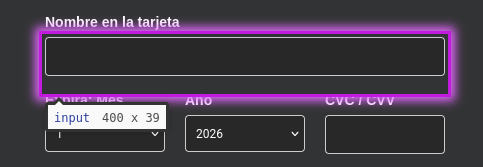

# 🐞 Reporte de Bug

## ID

BUG-008

## Título

Los campos de texto del formulario de compra no tienen etiqueta (`<label>`)

## Estado

- [x] Nuevo
- [ ] En revisión
- [ ] En desarrollo
- [ ] Resuelto
- [ ] Cerrado

## Reportado por

[Nombre del tester o estudiante]

## Fecha de detección

2026-10-23

## Prioridad

- 🟠 Alta (afecta al usuario de forma notoria)

## Descripción

El análisis de accesibilidad reporta la regla **"Form elements must have labels"** (impacto: *critical*) en 2 elementos. Los campos de texto del formulario de compra, dentro del iframe de venta de boletos (`#iFrame1`), no tienen `<label>` asociado, `aria-label`, `aria-labelledby` ni `title`, y su atributo `placeholder` está vacío.

Un usuario de lector de pantalla escucha solo "editar texto" sin saber qué dato debe escribir, lo que le impide completar la compra con seguridad.

## Pasos para reproducir

1. Acceder a [https://www.novacinemas.cr](https://www.novacinemas.cr).
2. Ir a la cartelera de una sucursal y seleccionar una tanda para comprar boletos.
3. Avanzar hasta el formulario de datos del comprador dentro del flujo de compra.
4. Ejecutar un análisis de accesibilidad con axe DevTools.
5. Revisar el resultado de la regla "Form elements must have labels".

## Resultado esperado

- Cada campo de texto tiene un `<label for="...">` visible asociado a su `id` que indique qué dato se solicita.

## Resultado obtenido

- Ubicación del elemento: `#iFrame1 input[placeholder=""][maxlength="50"][type="text"]`.
- Elemento: `<input type="text" placeholder="" maxlength="50" style="width: 100%; padding: 10px; margin-bottom: 15px; border: 1px solid rgb(204, 204, 204); border-radius: 4px; box-sizing: border-box;">`.
- Se reporta que se debe corregir al menos uno de los siguientes:
  - El elemento no tiene un `<label>` implícito (envolvente).
  - El elemento no tiene un `<label>` explícito.
  - El atributo `aria-label` no existe o está vacío.
  - El atributo `aria-labelledby` no existe, referencia elementos inexistentes o vacíos.
  - El elemento no tiene atributo `title`.
  - El elemento tiene un atributo `placeholder` vacío.
  - La semántica por defecto del elemento no se anuló con `role="none"` o `role="presentation"`.
- La regla reporta 2 elementos afectados en total.

## Evidencia

- Captura de pantalla: 

- Etiquetas del reporte: `cat.forms`, `wcag2a`, `wcag412`, `section508`, `section508.22.n`, `TTv5`, `TT5.c`, `EN-301-549`, `EN-9.4.1.2`, `ACT`.

## Entorno de pruebas

- Navegador: Zen Browser 1.23.4b (Firefox)
- Dispositivo: Escritorio
- Sistema operativo: Linux (Fedora 44)
- URL o versión del sistema: [https://www.novacinemas.cr](https://www.novacinemas.cr) (iframe: `web-ticketing.novacinemas.cr`)
- Herramienta: axe DevTools (axe Core 4.10.3), detectado automáticamente el 2026-10-23 a las 6:21 p. m.
- Estándar evaluado: WCAG 2.1 nivel AA

## Notas adicionales

- axe clasifica el impacto como *critical*, ya que el campo forma parte del flujo de compra.
- Usar solo `placeholder` como etiqueta tampoco es suficiente: desaparece al escribir y no todos los lectores de pantalla lo anuncian.
- Incumple WCAG 2.1, criterios 1.3.1 (Información y relaciones), 3.3.2 (Etiquetas o instrucciones) y 4.1.2 (Nombre, función, valor).
- Relacionado con [BUG-007](./07-select-sin-nombre-accesible.md).

