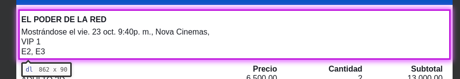

# 🐞 Reporte de Bug

## ID

BUG-009

## Título

La lista de definiciones (`<dl>`) del resumen de la película tiene una estructura inválida

## Estado

- [x] Nuevo
- [ ] En revisión
- [ ] En desarrollo
- [ ] Resuelto
- [ ] Cerrado

## Reportado por

Roberto Méndez

## Fecha de detección

2026-10-23

## Prioridad

- 🟡 Media

## Descripción

El análisis de accesibilidad reporta la regla **"`<dl>` elements must only directly contain properly-ordered `<dt>` and `<dd>` groups, `<script>`, `<template>` or `
` elements"** (impacto: *serious*). Dentro del iframe de venta de boletos (`#iFrame1`), el elemento `<dl>` que muestra los datos de la película no contiene ningún `<dt>` seguido de un `<dd>`, y uno de sus hijos directos es un `<dd>` con `role="heading"` (el nombre de la película), lo que no está permitido.

Los lectores de pantalla no pueden anunciar correctamente la relación entre términos y valores del resumen de la compra (película, sala, horario, etc.).

## Pasos para reproducir

1. Acceder a [https://www.novacinemas.cr](https://www.novacinemas.cr).
2. Ir a la cartelera de una sucursal y seleccionar una tanda para comprar boletos.
3. En la página de compra, ejecutar un análisis de accesibilidad con axe DevTools.
4. Revisar el resultado de la regla "`<dl>` elements must only directly contain properly-ordered `<dt>` and `<dd>` groups...".

## Resultado esperado

- El `<dl>` contiene pares ordenados de `<dt>` (término) y `<dd>` (valor), o bien el nombre de la película se marca con un encabezado real (`<h3>`) fuera de la lista.

## Resultado obtenido

- Ubicación del elemento: `#iFrame1 li > dl`.
- Elemento: `<dl>`.
- Se reporta que se deben corregir todos los siguientes:
  - El elemento no está vacío y no tiene al menos un `<dt>` seguido de al menos un `<dd>`.
  - El `<dl>` tiene hijos directos que no están permitidos: `[role=heading]`.
- Nodo relacionado: `<dd class="movie-name" role="heading" aria-level="3">STREET FIGHTER</dd>`.

## Evidencia

- Captura de pantalla: 

- Etiquetas del reporte: `cat.structure`, `wcag2a`, `wcag131`, `EN-301-549`, `EN-9.1.3.1`.

## Entorno de pruebas

- Navegador: Zen Browser 1.23.4b (Firefox)
- Dispositivo: Escritorio
- Sistema operativo: Linux (Fedora 44)
- URL o versión del sistema: [https://www.novacinemas.cr](https://www.novacinemas.cr) (iframe: `web-ticketing.novacinemas.cr`)
- Herramienta: axe DevTools (axe Core 4.10.3), detectado automáticamente el 2026-10-23 a las 6:21 p. m.
- Estándar evaluado: WCAG 2.1 nivel AA

## Notas adicionales

- Incumple WCAG 2.1, criterio 1.3.1 (Información y relaciones).
- Referencia: [axe — definition-list](https://dequeuniversity.com/rules/axe/4.10/definition-list)
