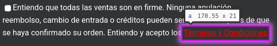
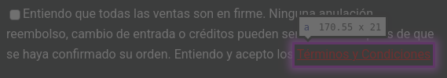
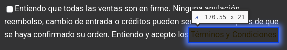

# 🐞 Reporte de Bug

## ID

BUG-010

## Título

El enlace "Términos y Condiciones" del formulario de compra no cumple el contraste mínimo (3.99:1)

## Estado

- [x] Nuevo
- [ ] En revisión
- [ ] En desarrollo
- [ ] Resuelto
- [ ] Cerrado

## Reportado por

Roberto Méndez

## Fecha de detección

2026-10-23

## Prioridad

- 🟡 Media

## Descripción

El análisis de accesibilidad reporta la regla **"Elements must meet minimum color contrast ratio thresholds"** (impacto: *serious*) en 6 elementos de la página de compra. Uno de ellos es el enlace "Términos y Condiciones" dentro del iframe de venta de boletos (`#iFrame1`): el texto rojo (`#ff0000`) sobre fondo blanco (`#ffffff`) tiene un contraste de **3.99:1**, por debajo del **4.5:1** que exige WCAG 2 AA para texto de 16px con peso normal.

El enlace lleva a las condiciones que el usuario acepta al comprar, por lo que debe poder leerse con facilidad.

## Pasos para reproducir

1. Acceder a [https://www.novacinemas.cr](https://www.novacinemas.cr).
2. Ir a la cartelera de una sucursal y seleccionar una tanda para comprar boletos.
3. Avanzar hasta el formulario de compra donde aparece el enlace "Términos y Condiciones".
4. Ejecutar un análisis de accesibilidad con axe DevTools.
5. Revisar el resultado de la regla "Elements must meet minimum color contrast ratio thresholds".

## Resultado esperado

- El texto del enlace tiene un contraste de al menos 4.5:1 con su fondo (WCAG 2.1, criterio 1.4.3, nivel AA).

## Resultado obtenido

- Se reporta: `Element has insufficient color contrast of 3.99 (foreground color: #ff0000, background color: #ffffff, font size: 12.0pt (16px), font weight: normal). Expected contrast ratio of 4.5:1`.
- Ubicación del elemento: `#iFrame1 a[target="_blank"]`.
- Elemento: `<a href=" https://www.novacinemas.cr/terminos-y-condiciones-de-compra/ " target="_blank">Términos y Condiciones</a>`.
- La regla reporta 6 elementos afectados en total.

## Evidencia

- Captura de pantalla base: 

- Captura de pantalla con simulación de bajo contraste:

- Captura de pantalla con simulación de Protanopia (No ver rojos):

- Etiquetas del reporte: `cat.color`, `wcag2aa`, `wcag143`, `TTv5`, `TT13.c`, `EN-301-549`, `EN-9.1.4.3`, `ACT`.

## Entorno de pruebas

- Navegador: Zen Browser 1.23.4b (Firefox)
- Dispositivo: Escritorio
- Sistema operativo: Linux (Fedora 44)
- URL o versión del sistema: [https://www.novacinemas.cr](https://www.novacinemas.cr) (iframe: `web-ticketing.novacinemas.cr`)
- Herramienta: axe DevTools (axe Core 4.10.3), detectado automáticamente el 2026-10-23 a las 6:21 p. m.
- Estándar evaluado: WCAG 2.1 nivel AA

## Notas adicionales

- Solución sugerida: usar un rojo más oscuro, por ejemplo `#d00000` (≈5.7:1 sobre blanco).
- Relacionado con [BUG-002](./02-contraste-color-insuficiente.md) y [BUG-004](./04-contraste-titulo-lugar.md).
