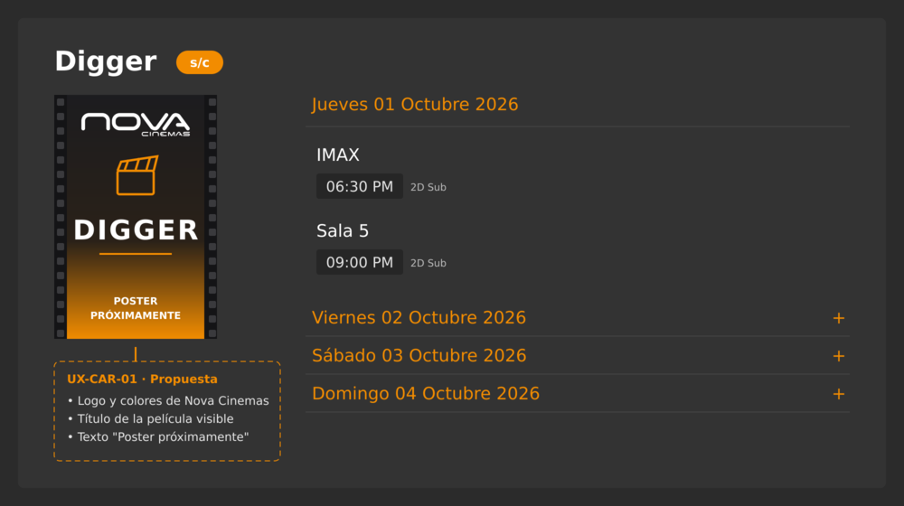
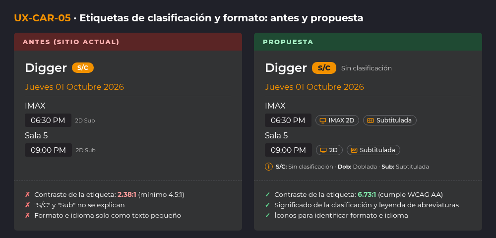
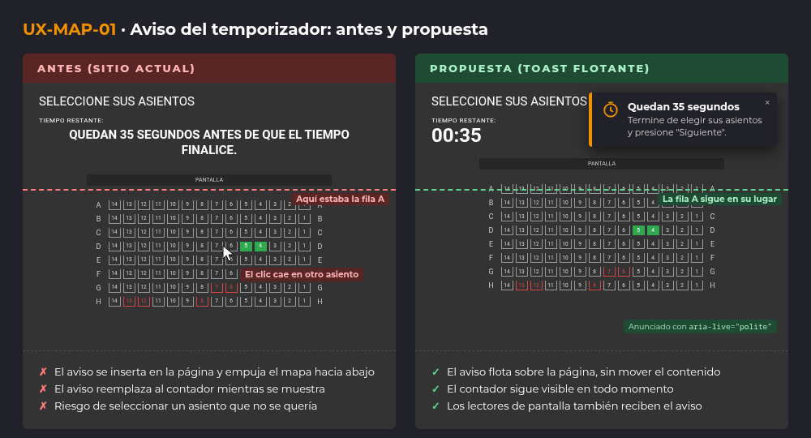
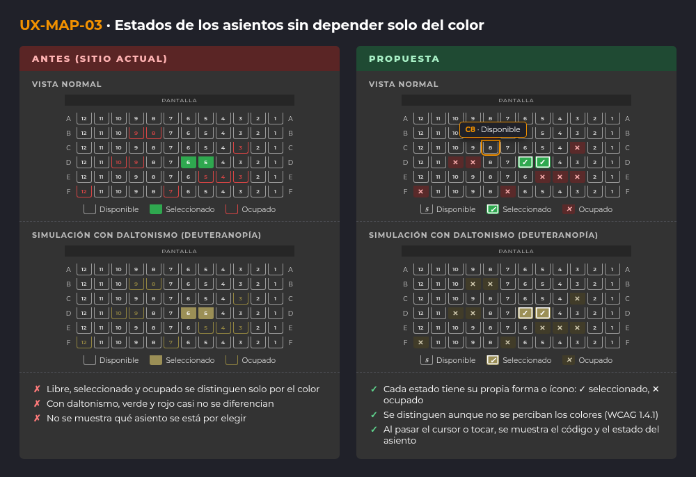
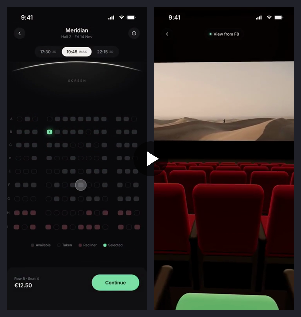
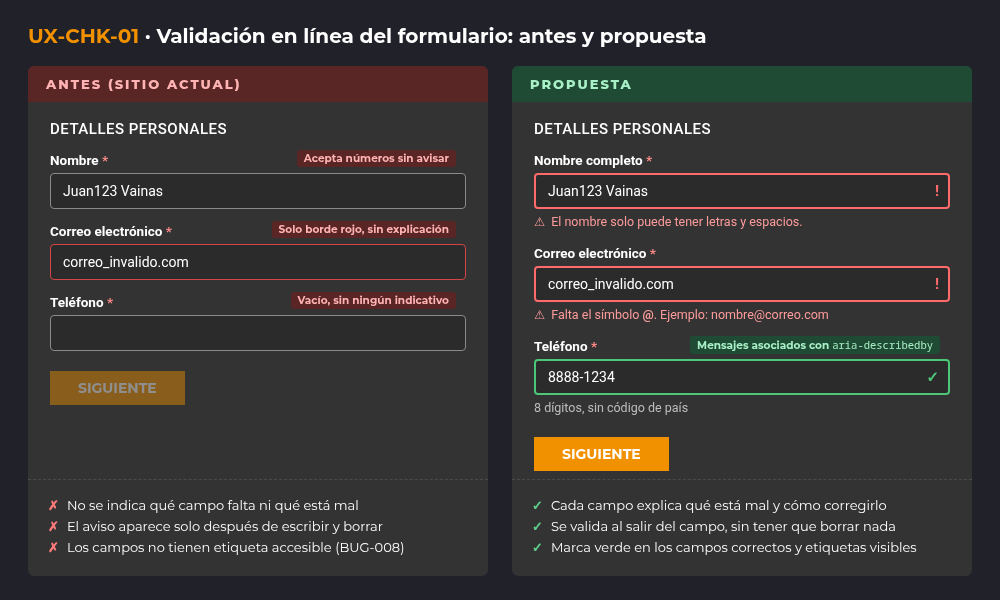
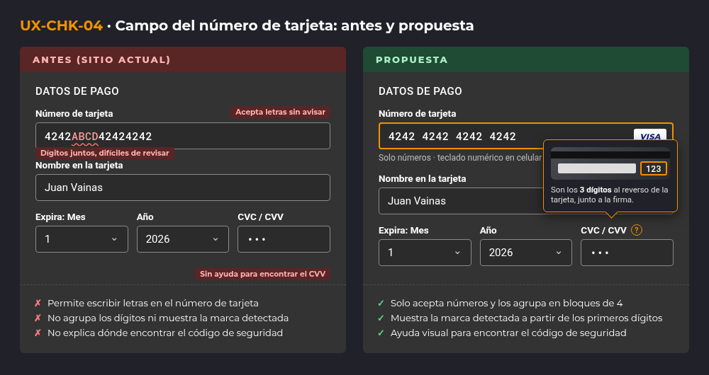
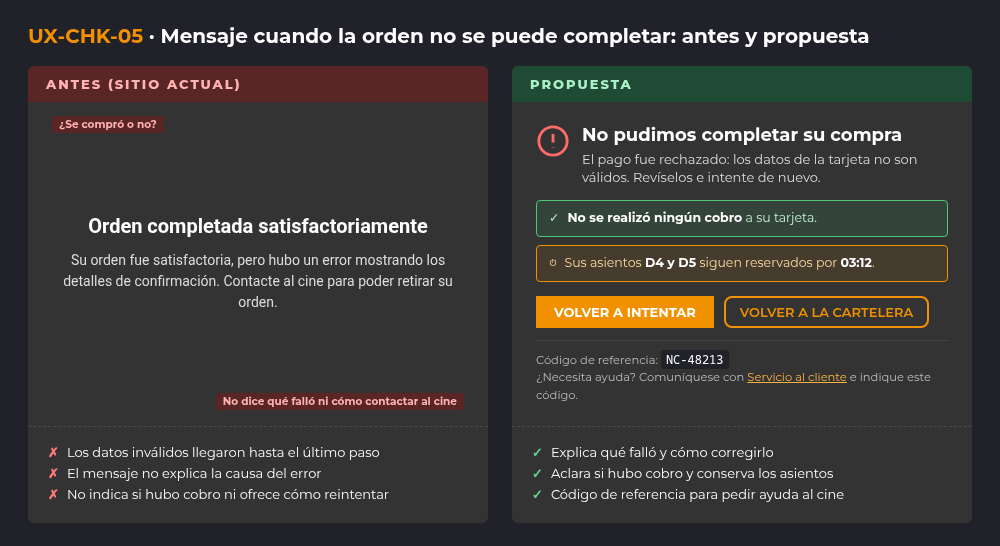

# Tarea #4: Propuestas de Mejora de UI/UX - Nova Cinemas

Se presentan propuestas de mejora de **interfaz (UI)** y **experiencia de usuario (UX)** para el sitio de compra de boletos de **Nova Cinemas** ([https://www.novacinemas.cr](https://www.novacinemas.cr)). Las propuestas parten de las tres funcionalidades críticas evaluadas en la [Tarea #2](../Tarea%202/README.md).

Cada propuesta indica el problema observado, la mejora sugerida y la heurística de usabilidad que la respalda (Nielsen).

*Apoyo con la herramienta de IA: Claude Opus 5.5*

---

## Resumen de Propuestas

| ID | Sección | Propuesta | Tipo |
| :-: | :--- | :--- | :-: |
| UX-CAR-01 | Cartelera | Imagen alternativa con diseño de marca para películas sin poster | UI |
| UX-CAR-02 | Cartelera | Corregir el enlace roto del poster y unificar la navegación a la cartelera | UX |
| UX-CAR-03 | Cartelera | Recordar la sucursal elegida por el usuario | UX |
| UX-CAR-04 | Cartelera | Filtros por formato e idioma en la cartelera | UX |
| UX-CAR-05 | Cartelera | Mejorar el contraste y la leyenda de las etiquetas de clasificación y formato | UI |
| UX-MAP-01 | Mapa de asientos | Aviso del temporizador sin desplazar el mapa | UI |
| UX-MAP-02 | Mapa de asientos | Temporizador fijo con barra de progreso y cambio de color | UI |
| UX-MAP-03 | Mapa de asientos | Leyenda y estados de asientos que no dependan solo del color | UI |
| UX-MAP-04 | Mapa de asientos | Vista previa de la pantalla desde el asiento seleccionado | UX |
| UX-CHK-01 | Checkout | Validación en línea con mensajes de error por campo | UX |
| UX-CHK-02 | Checkout | Explicar por qué el botón "Siguiente" está deshabilitado | UX |
| UX-CHK-03 | Checkout | Validar formato de nombre y teléfono | UX |
| UX-CHK-04 | Checkout | Formato automático e identificación de marca en el número de tarjeta | UI |
| UX-CHK-05 | Checkout | Mensaje claro cuando la orden no se puede completar | UX |

---

# Sección 1: Consulta de Cartelera

## UX-CAR-01: Imagen alternativa con diseño de marca para películas sin poster

- **Tipo:** UI
- **Problema observado:** Una película próxima a estrenarse muestra un placeholder genérico en lugar de su poster (CT-CAR-01, CT-CAR-03). Da la impresión de que la página está rota.

- **Propuesta:**
  - Reemplazar el placeholder genérico por una tarjeta con los colores de Nova Cinemas que muestre el **título de la película** en grande y el texto "Poster próximamente".
  - Incluir un `alt` descriptivo con el nombre de la película.
- **Ejemplo de la propuesta:**

- **Heurística:** Consistencia y estándares; Diseño estético y minimalista.
- **Beneficio esperado:** El usuario identifica la película aunque falte la imagen y el sitio no se percibe como roto.

## UX-CAR-02: Corregir el enlace roto del poster y unificar la navegación a la cartelera

- **Tipo:** UX
- **Problema observado:** Al entrar a la cartelera desde el menú desplegable de la barra del logo, el poster es clicable pero lleva a una página que solo dice "ERROR" (CT-CAR-03). Además, existen dos caminos distintos para llegar a la cartelera que se comportan diferente.

- **Propuesta:**
  - Hacer que el clic en el poster abra una **página de detalle de la película** (sinopsis, duración, clasificación, tráiler y horarios).
  - Si el detalle no está disponible, que el poster no sea clicable, o que lleve a los horarios de esa película.
  - Unificar ambos accesos a la cartelera para que lleven a la misma vista.
  - Reemplazar la página "ERROR" por una página de error amigable con un botón "Volver a la cartelera".
- **Ejemplo de la propuesta:**

> [!TIP]
> **Ejemplo interactivo en HTML:** [CAR-02-detalle-pelicula.html](ejemplos/CAR-02-detalle-pelicula.html)
>
> Incluye la cartelera con el poster clicable, la página de detalle de la película y la página de error amigable.

- **Heurística:** Consistencia y estándares; Ayudar a reconocer, diagnosticar y recuperarse de errores.
- **Beneficio esperado:** Se elimina un callejón sin salida en el flujo principal de compra.

## UX-CAR-03: Recordar la sucursal elegida por el usuario

- **Tipo:** UX
- **Problema observado:** Para ver horarios el usuario debe ir a "Cartelera" y elegir el cine en el selector "Elegir Cine :" cada vez que entra (CT-CAR-01).
- **Propuesta:**
  - Guardar la última sucursal elegida y mostrarla preseleccionada en la siguiente visita.
  - Ofrecer (con permiso del usuario) sugerir la sucursal más cercana según su ubicación.
  - Mostrar la sucursal actual de forma visible en el encabezado con opción "Cambiar".
- **Heurística:** Flexibilidad y eficiencia de uso; Reconocer antes que recordar.
- **Beneficio esperado:** Menos pasos para llegar a los horarios, sobre todo para clientes frecuentes.

## UX-CAR-04: Filtros por formato e idioma en la cartelera

- **Tipo:** UX
- **Problema observado:** Cada película muestra sus formatos (2D, 3D, IMAX) e idioma (Dob, Sub) solo junto a cada horario (CT-CAR-03). Un usuario que busca, por ejemplo, una función en IMAX o una película doblada debe revisar todas las tarjetas y abrir cada fecha del acordeón una por una.
- **Propuesta:**
  - Agregar una fila de **chips de filtro** arriba de la cartelera: "IMAX", "3D", "2D", "Doblada", "Subtitulada".
  - Permitir combinar filtros (ej. "IMAX" + "Subtitulada") y mostrar solo las películas y tandas que cumplan.
  - Indicar cuántos resultados hay (ej. "4 películas") y ofrecer un botón "Limpiar filtros".
  - Si ninguna película cumple, mostrar un mensaje claro en lugar de una lista vacía: *"No hay funciones en IMAX para esta fecha."*
- **Ejemplo de la propuesta:**

> [!TIP]
> **Ejemplo interactivo en HTML:** [CAR-04-filtros-cartelera.html](ejemplos/CAR-04-filtros-cartelera.html)
>
> Incluye los filtros funcionando, el contador de resultados y el mensaje cuando no hay funciones. Las películas son ficticias.

- **Heurística:** Flexibilidad y eficiencia de uso; Reconocer antes que recordar.
- **Beneficio esperado:** El usuario encuentra en segundos las funciones que le interesan, sin recorrer toda la cartelera.

## UX-CAR-05: Mejorar el contraste y la leyenda de etiquetas de clasificación y formato

- **Tipo:** UI
- **Problema observado:** Las etiquetas de clasificación de edad (TP, +12, +18, S/C) tienen un contraste de 2.37:1 ([BUG-002](../Tarea%203/issues/02-contraste-color-insuficiente.md)). Además, abreviaturas como "S/C" o "2D Dob" no se explican.
- **Propuesta:**
  - Ajustar los colores de las etiquetas para cumplir un contraste mínimo de 4.5:1 (WCAG AA).
  - Agregar un *tooltip* o una pequeña leyenda que explique cada abreviatura ("S/C: Sin clasificación", "Dob: Doblada", "Sub: Subtitulada").
  - Diferenciar visualmente los formatos (2D, 3D, IMAX) con un ícono además del texto.
- **Ejemplo de la propuesta:**

- **Heurística:** Reconocer antes que recordar; Ayuda y documentación.
- **Beneficio esperado:** Información más legible y comprensible, también para personas con baja visión.

---

# Sección 2: Mapa Interactivo de Asientos

## UX-MAP-01: Aviso del temporizador sin desplazar el mapa

- **Tipo:** UI
- **Problema observado:** Cuando queda poco tiempo aparece un aviso que empuja el mapa de asientos unos píxeles hacia abajo (CT-MAP-03). Si el usuario está por hacer clic, puede seleccionar un asiento distinto al que quería.

- **Propuesta:**
  - Mostrar el aviso como un **mensaje flotante** (*toast*) o reservar desde el inicio el espacio que ocupará, para que el contenido no se mueva.
  - Anunciar el aviso a lectores de pantalla con `aria-live="polite"`.
- **Ejemplo de la propuesta:**

- **Heurística:** Prevención de errores.
- **Beneficio esperado:** Se eliminan selecciones accidentales de asientos causadas por el movimiento del diseño.

## UX-MAP-02: Temporizador fijo con barra de progreso y cambio de color

- **Tipo:** UI
- **Problema observado:** El usuario solo se entera de que el tiempo se acaba cuando aparecen los avisos de últimos minutos (CT-MAP-03).
- **Propuesta:**
  - Mantener el temporizador **siempre visible** (fijo en la parte superior, también al hacer scroll).
  - Acompañarlo de una barra de progreso que cambie de color: verde → amarillo (menos de 2 min) → rojo (menos de 30 s).
- **Ejemplo de la propuesta:**

> [!TIP]
> **Ejemplo interactivo en HTML:** [MAP-02-temporizador.html](ejemplos/MAP-02-temporizador.html)
>
> Incluye el temporizador fijo al hacer scroll, la barra de progreso con sus tres estados y controles para adelantar el tiempo.

- **Heurística:** Visibilidad del estado del sistema.
- **Beneficio esperado:** El usuario controla su tiempo de compra sin sorpresas.

## UX-MAP-03: Leyenda y estados de asientos que no dependan solo del color

- **Tipo:** UI
- **Problema observado:** Los estados de los asientos se distinguen únicamente por color: gris (libre), verde (seleccionado) y rojo (ocupado) (CT-MAP-01, CT-MAP-02). Rojo y verde son difíciles de diferenciar para personas con daltonismo.
- **Propuesta:**
  - Agregar un ícono o patrón a cada estado (ej. ✓ en los seleccionados, ✕ en los ocupados).
  - Mostrar al pasar el cursor (o al tocar en móvil) el código del asiento (ej. "F8").
  - Mantener la leyenda siempre visible junto al mapa.
- **Ejemplo de la propuesta:** la parte inferior de cada panel simula cómo ve el mapa una persona con deuteranopía (el tipo de daltonismo más común).

- **Heurística:** Reconocer antes que recordar; Accesibilidad (WCAG 1.4.1 Uso del color).
- **Beneficio esperado:** Todos los usuarios distinguen correctamente el estado de cada butaca.

## UX-MAP-04: Vista previa de la pantalla desde el asiento seleccionado

- **Tipo:** UX
- **Problema observado:** El mapa de asientos es una vista plana desde arriba, con una franja que dice "PANTALLA" (CT-MAP-01). Con eso el usuario no puede saber cómo se verá la película desde un asiento: si queda muy cerca, muy de lado o si la pantalla se verá pequeña. Hoy solo se puede adivinar a partir de la letra de la fila y el número del asiento, y se descubre al llegar a la sala.
- **Propuesta:**
  - Al seleccionar un asiento, mostrar un botón **"Ver desde mi asiento"** junto a la selección.
  - Al presionarlo, cambiar la perspectiva del mapa a una vista en primera persona, desde la altura y la posición de ese asiento, que muestre la pantalla, las filas de adelante y el ángulo de visión.
  - Permitir pasar de un asiento seleccionado a otro (ej. D4 → D5) y volver al mapa normal con un botón **"Volver al mapa"**, sin perder la selección.
  - Generar la vista con un modelo 3D sencillo de la sala, armado con los mismos datos del mapa (filas, columnas y posición de la pantalla), para no tener que tomar fotos de cada asiento.
  - Mantener el mapa plano como vista principal; la perspectiva es una ayuda opcional y no un paso obligatorio de la compra.
- **Referencia visual:** concepto de una aplicación de cine con una funcionalidad similar, que sirvió de inspiración para esta propuesta. No es un diseño de Nova Cinemas. Haga clic en la imagen para ver el video.

  

  *Fuente: publicación de Ramin Nasibov ([@RaminNasibov](https://x.com/RaminNasibov)) en X: [https://x.com/RaminNasibov/status/2119378104892211287](https://x.com/RaminNasibov/status/2119378104892211287). Consultado el 13/11/2026.*

- **Heurística:** Correspondencia entre el sistema y el mundo real; Reconocer antes que recordar.
- **Beneficio esperado:** El usuario elige su asiento con más seguridad, sobre todo en salas grandes o en formatos como IMAX, donde la ubicación cambia mucho la experiencia. También baja la probabilidad de que llegue a la sala y no le guste su asiento.

---

# Sección 3: Formulario de Datos Personales y Checkout

## UX-CHK-01: Validación en línea con mensajes de error por campo

- **Tipo:** UX
- **Problema observado:** Los campos obligatorios solo muestran un indicativo después de escribir algo y borrarlo. No hay mensajes que indiquen qué falta o qué está mal, excepto en el correo (CT-CHK-01, CT-CHK-04). Además, los campos no tienen etiquetas accesibles ([BUG-008](../Tarea%203/issues/08-campos-formulario-sin-etiqueta.md)).
- **Propuesta:**
  - Validar cada campo al salir de él (*on blur*) y mostrar un mensaje debajo, en rojo y con ícono: *"Ingresa tu número de teléfono (8 dígitos)."*
  - Marcar con ✓ verde los campos correctos.
  - Usar etiquetas `<label>` visibles en todos los campos y asociar los mensajes de error con `aria-describedby`.
- **Ejemplo de la propuesta:**

- **Heurística:** Prevención de errores; Ayudar a reconocer, diagnosticar y recuperarse de errores.
- **Beneficio esperado:** El usuario sabe en todo momento qué debe corregir y completa el formulario más rápido.

## UX-CHK-02: Explicar por qué el botón "Siguiente" está deshabilitado

- **Tipo:** UX
- **Problema observado:** El botón "Siguiente" permanece deshabilitado mientras falten datos o haya datos inválidos, pero no se indica el motivo (CT-CHK-01, CT-CHK-04). El usuario no sabe qué hacer para continuar.
- **Propuesta:**
  - Mantener el botón **habilitado**; al presionarlo con errores, desplazar la vista al primer campo con error y resaltarlo.
  - Alternativamente, mostrar junto al botón un texto como *"Faltan 2 campos por completar"*.
- **Heurística:** Visibilidad del estado del sistema; Ayudar a reconocer errores.
- **Beneficio esperado:** Se evita que el usuario quede bloqueado sin explicación y abandone la compra.

## UX-CHK-03: Validar formato de nombre y teléfono

- **Tipo:** UX
- **Problema observado:** El nombre acepta números y símbolos (ej. `Juan123 Vainas`) y el teléfono no se valida. Con datos absurdos el sistema permite continuar y termina con un mensaje confuso (CT-CHK-01).
- **Propuesta:**
  - Nombre: aceptar solo letras, espacios, tildes y guiones.
  - Teléfono: usar `type="tel"`, aplicar máscara `####-####` y validar 8 dígitos (formato de Costa Rica).
  - Usar `autocomplete` (`name`, `email`, `tel`) para que el navegador complete los datos.
- **Heurística:** Prevención de errores; Flexibilidad y eficiencia de uso.
- **Beneficio esperado:** Datos de contacto válidos para que el cine pueda comunicarse con el cliente si hay algún problema con la orden.

## UX-CHK-04: Formato automático e identificación de marca en el número de tarjeta

- **Tipo:** UI
- **Problema observado:** El campo de número de tarjeta permite escribir letras y no da retroalimentación sobre el formato (CT-CHK-04).
- **Propuesta:**
  - Bloquear caracteres no numéricos y usar `inputmode="numeric"` para mostrar el teclado numérico en móvil.
  - Agrupar automáticamente los dígitos en bloques de 4 (`4242 4242 4242 4242`).
  - Mostrar el logo de la marca (Visa, Mastercard, Amex) detectada a partir de los primeros dígitos.
  - Agregar un ícono de ayuda junto al CVV que indique dónde encontrarlo.
- **Ejemplo de la propuesta:**

- **Heurística:** Prevención de errores; Correspondencia entre el sistema y el mundo real.
- **Beneficio esperado:** Menos errores de digitación y mayor confianza al pagar.

## UX-CHK-05: Mensaje claro cuando la orden no se puede completar

- **Tipo:** UX
- **Problema observado:** En la prueba se usaron datos que no son reales, por lo que era esperable que la compra no se completara. Sin embargo, esos datos pasaron todas las validaciones del formulario y el error recién se manifestó en el último paso, con un mensaje genérico: *"Orden completada satisfactoriamente. Su orden fue satisfactoria, pero hubo un error mostrando los detalles de confirmación. Contacte al cine para poder retirar su orden."* (CT-CHK-01). El mensaje no explica qué falló ni qué puede hacer el usuario para corregirlo, y un usuario real que se haya equivocado al escribir un dato no sabría si su compra se realizó o no.
- **Propuesta:**
  - Detectar los datos inválidos **antes** de enviar la orden (ver UX-CHK-01 y UX-CHK-03), para que el error no llegue hasta la pantalla final.
  - Si la orden falla en el último paso, mostrar un mensaje específico según la causa, por ejemplo: *"No pudimos procesar el pago. Revise los datos de la tarjeta e intente de nuevo."*
  - Indicar de forma explícita si se realizó o no algún cobro, para que el usuario no tenga dudas.
  - Ofrecer un botón **"Volver a intentar"** que regrese al formulario con los datos y los asientos conservados, mientras la reserva siga vigente.
  - Mostrar un código de referencia del error y un medio de contacto del cine, por si el usuario necesita ayuda.
- **Ejemplo de la propuesta:**

- **Heurística:** Ayudar a reconocer, diagnosticar y recuperarse de errores; Visibilidad del estado del sistema.
- **Beneficio esperado:** El usuario entiende qué pasó, sabe si se le cobró y puede corregir el problema sin empezar la compra desde cero.

